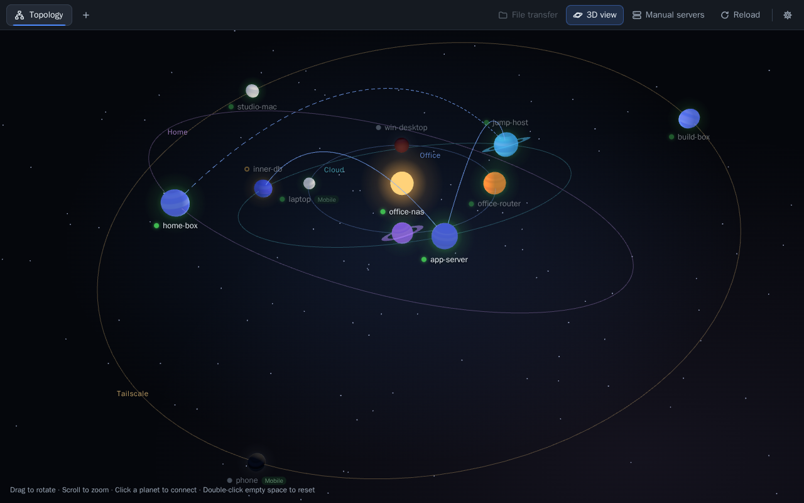
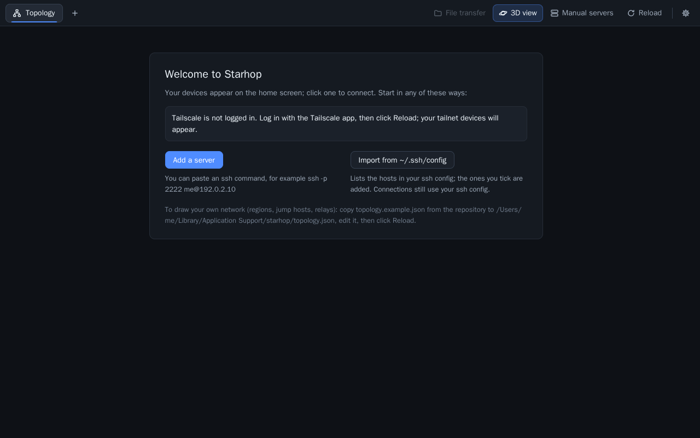

# Starhop

A lightweight SSH client for macOS and Windows that shows your servers as a map. Regions are orbits, devices are planets, jump hosts are arcs between them. Click a planet and it connects with your system `ssh`, so your `~/.ssh/config`, keys, ssh-agent and Tailscale SSH work as they do in a terminal.

[简体中文](README.zh-CN.md) · [User guide](docs/guide.md) · [Contributing](CONTRIBUTING.md)



## Features

- **No setup to start.** Tailscale devices appear on the home screen by themselves. Add other servers by pasting an `ssh` command, or import the hosts in your `~/.ssh/config`.
- **A map of your network,** in 3D (planets and orbits) or 2D (a diagram), drawn from an optional `topology.json`: regions, device types, jump hosts (ProxyJump) and relay commands such as `tailscale nc %h %p`.
- **Online status** for every device, worked out on your computer: from Tailscale, or by checking the SSH port. Nothing is installed on your servers.
- **Tabs** for up to 8 sessions, with keyboard shortcuts.
- **File transfer (SFTP)** in the same tab: two panes, drag and drop, progress, retry.
- **Copy and paste** that behaves: a whole selection is copied, multi-line pastes ask first, and `tmux`/`vim` copies (OSC 52) reach your clipboard.
- **Themes and fonts:** eight colour themes, 256 colours and true colour, the bundled JetBrains Mono, and UI zoom.
- **English and Chinese** interface, following your system language.
- Optional, off by default: **remote shell beautify** (colours for `ls`, prompt and zsh on the server) and a **login lock** for the app.

## Install

Download the installer from the [Releases page](https://github.com/laugie/starhop/releases/latest):

| System | File |
| --- | --- |
| macOS 11 or later, Apple Silicon (M1 and later) | `Starhop_<version>_aarch64.dmg` |
| Windows 10/11, 64-bit | `Starhop_<version>_x64-setup.exe` |

Intel Macs: there is no installer yet, so [build from source](#build-from-source).

The installers are built by GitHub Actions and are **not code-signed**, so the system warns the first time you open them:

- **macOS** says the app "cannot be opened" or "is damaged". Drag Starhop to Applications, then right-click it and choose **Open**. If that does not help, run `xattr -dr com.apple.quarantine /Applications/Starhop.app` in Terminal.
- **Windows** SmartScreen says it protected your PC. Choose **More info > Run anyway**.

The app also needs `ssh`: built into macOS; on Windows, turn on OpenSSH Client (Settings > System > Optional features).

### Build from source

| | macOS 11 or later | Windows 10/11 |
| --- | --- | --- |
| Build tools | Xcode Command Line Tools: `xcode-select --install` | [Microsoft C++ Build Tools](https://visualstudio.microsoft.com/visual-cpp-build-tools/), workload "Desktop development with C++" |
| Web view | built in | WebView2 Runtime (built into Windows 11 and current Windows 10) |
| Node.js | 22 | 22 |
| Rust | stable, from [rustup.rs](https://rustup.rs) | stable (MSVC), from [rustup.rs](https://rustup.rs) |
| ssh | built in | OpenSSH Client (Settings > System > Optional features) |

```sh
git clone https://github.com/laugie/starhop.git
cd starhop
npm ci
npm run tauri build
```

The app is then in `src-tauri/target/release/bundle/`:

- macOS: `macos/Starhop.app` (drag it to Applications) and `dmg/Starhop_<version>_<arch>.dmg`
- Windows: `nsis/Starhop_<version>_x64-setup.exe`

The build is not code-signed. An app you build on your own computer opens normally. If you copy it to another computer, macOS Gatekeeper and Windows SmartScreen will warn: on macOS, right-click the app and choose **Open**; on Windows, choose **More info > Run anyway**.

To work on the app with hot reload, run `npm run tauri dev` instead.

Linux is not supported yet (see the [roadmap](ROADMAP.md)).

## Getting started

1. Open Starhop. With Tailscale installed and logged in, your tailnet devices are already on the home screen. Click one to connect.
2. Add other servers on the **Manual servers** page: paste `ssh -p 2222 me@192.0.2.10` (or `me@host:22`) and click **Fill in**, or use **Import from ~/.ssh/config** and tick the hosts you want.
3. Optional: describe your network in `topology.json` to get regions, jump hosts and relays. Copy [topology.example.json](topology.example.json) to:
   - macOS: `~/Library/Application Support/starhop/topology.json`
   - Windows: `%APPDATA%\starhop\topology.json`

   then click **Reload**. The [user guide](docs/guide.md) lists every field.



## Configuration

Starhop keeps two files in the folder above: `topology.json` (yours; the app never writes it) and `config.json` (settings, written by the app). Change settings with the gear button: language, theme, font, zoom, and the optional add-ons are all there.

Settings > **Language** offers "Same as system", English and 简体中文; it applies after a restart.

## Privacy and security

No telemetry, no account, no update check. Starhop stores no SSH passwords; authentication is your keys, ssh-agent or Tailscale SSH. Besides the connections you open, the only network activity is the online-status check and the local `tailscale status`. [SECURITY.md](SECURITY.md) lists everything and explains how to report a vulnerability.

## Optional add-ons

Both are off until you turn them on in Settings. The [user guide](docs/guide.md) has the details.

- **Remote shell beautify** changes files on your servers: it backs up `~/.bashrc` / `~/.zshrc`, adds colours for `ls`, a coloured prompt and zsh syntax highlighting, and can restore the backup.
- **Login lock** asks for a username and password when the app starts. Only a password hash is kept, in the system keychain.

## Contributing

Issues and pull requests are welcome. Read [CONTRIBUTING.md](CONTRIBUTING.md) first. If you use an AI coding agent, point it at [AGENTS.md](AGENTS.md).

## Licence

Starhop is licensed under either of [MIT](LICENSE-MIT) or [Apache-2.0](LICENSE-APACHE), at your option. Third-party components and their licences are listed in [docs/THIRD_PARTY_LICENSES.md](docs/THIRD_PARTY_LICENSES.md).

Starhop is not affiliated with Tailscale Inc.
