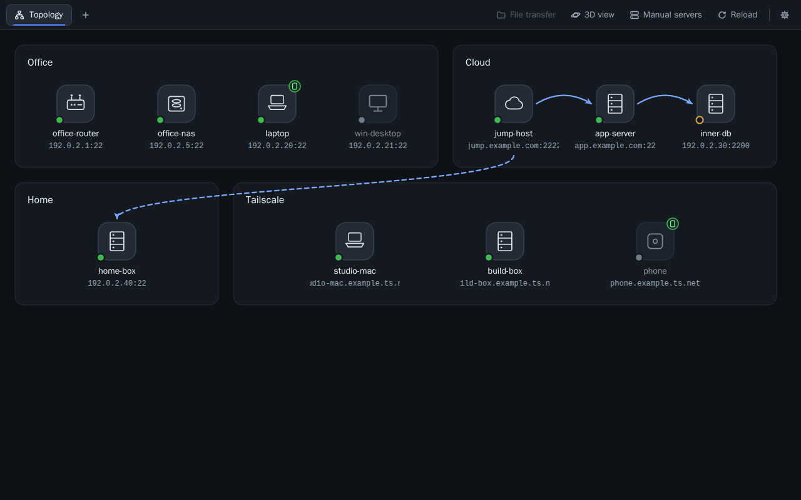

# Starhop user guide

Starhop is a lightweight SSH client for macOS and Windows. It runs the system `ssh` in a terminal tab, so your `~/.ssh/config`, keys, ssh-agent and Tailscale SSH work the same way they do in a normal terminal. Starhop does not store SSH passwords.

This guide describes what the app does and where it keeps its files. Build instructions are in the [README](../README.md).

Contents:

1. [Home screen](#1-home-screen)
2. [topology.json reference](#2-topologyjson-reference)
3. [Tabs and keyboard shortcuts](#3-tabs-and-keyboard-shortcuts)
4. [Copy and paste](#4-copy-and-paste)
5. [File transfer (SFTP)](#5-file-transfer-sftp)
6. [Appearance](#6-appearance)
7. [Language](#7-language)
8. [Optional add-ons (off by default)](#8-optional-add-ons-off-by-default)
9. [Closing and quitting](#9-closing-and-quitting)
10. [Input methods (IME)](#10-input-methods-ime)
11. [Upgrading from my-terminal](#11-upgrading-from-my-terminal)

## Where the files are

Starhop keeps `config.json` (settings, written by the app) and `topology.json` (your network, written by you) in one folder:

| System | Folder |
| --- | --- |
| macOS | `~/Library/Application Support/starhop/` |
| Windows | `%APPDATA%\starhop\` |

Prefer the Settings dialog (the gear icon at the right end of the toolbar) over editing `config.json`. If you do edit it, close the app first.

## 1. Home screen



The home screen is always the first tab. It shows your devices. Click a device to open an SSH session to it in a new tab.

You do not need a config file to start. The home screen shows devices from three sources:

| Source | Shown as | Where it comes from |
| --- | --- | --- |
| `topology.json` | Your own regions | A file you write. See [section 2](#2-topologyjson-reference). |
| Tailscale | A region named "Tailscale" | The other devices in your tailnet, when Tailscale is installed and logged in on this computer. |
| Manual servers | A region named "Manual servers" | Servers you add in the app. Saved in `config.json` under `manualHosts`. |

### Tailscale devices

When Tailscale is installed and logged in, the other devices in your tailnet appear on their own orbit (a group box in the 2D view) named "Tailscale".

- Online status comes from Tailscale.
- The icon follows the device's operating system: Mac, Windows or server. Phones and tablets are marked as mobile devices.
- Clicking one runs your local `ssh` to its MagicDNS name, for example `laptop.example.ts.net`. No user name is passed, so with Tailscale SSH you log in directly.
- A device already in `topology.json` is not shown twice. It counts as the same device when its `host` or `tailscaleAddress` equals the peer's Tailscale IP or name.

### Manual servers

Open the "Manual servers" page from the right side of the toolbar. Click it again, or click the home tab, to go back to the map. The page also lists the Tailscale devices.

A manual server has a name, a host, and an optional user and port. Saved entries go to `config.json` under `manualHosts`:

```json
"manualHosts": [
  {"name": "web", "host": "198.51.100.7", "user": "me", "port": 2222},
  {"name": "build", "host": "build"}
]
```

If you leave the port empty, ssh chooses it: 22, or the `Port` from `~/.ssh/config`.

#### Paste an ssh command

The add form has a "Paste an ssh command" box. Paste a command or an address and click the fill-in button. The form fills in the name, host, user and port. Check them, then click the add button.

Accepted forms:

| Form | Example |
| --- | --- |
| `ssh [-p port] [-l user] [user@]host` | `ssh -p 2222 me@192.0.2.10` |
| `ssh://user@host:port` | `ssh://me@host.example.com:2222` |
| `user@host:port` | `me@192.0.2.10:2222` |
| `[IPv6]:port` | `[2001:db8::10]:2222` |

- Options such as `-i`, `-J` and `-o` cannot be saved in the form. The app tells you to put them in `~/.ssh/config` and import the host from there.
- A pasted command that includes a remote command, or characters such as `;`, `|`, `$` or quotes, is rejected.

#### Import from ~/.ssh/config

"Import from ~/.ssh/config" reads `~/.ssh/config` and the files it pulls in with `Include` (up to 4 levels deep and 32 files). It lists the host aliases from `Host` lines.

- Patterns that contain `*`, `?` or `!` are skipped. `Match` blocks are skipped.
- Aliases you have already added are not listed again.
- Tick the aliases you want and click the import button. Each alias becomes a manual server whose name and host are both the alias. No user or port is saved, so ssh still applies the `HostName`, `User`, `Port`, keys and jump hosts from your ssh config.
- The app only reads your ssh config. It never changes it.

### Welcome screen

When the home screen has no devices at all (no `topology.json`, no Tailscale devices, no manual servers), it shows a welcome screen instead. It tells you the Tailscale state (not installed, not running, not logged in, or no other devices in the tailnet) and offers two buttons: "Add a server" and "Import from ~/.ssh/config". It also tells you where to put a `topology.json` if you want to draw your own network.

### Names and errors

- Starhop never writes `topology.json`.
- If a Tailscale device or manual server has the same name as a device in `topology.json`, the app adds " · Tailscale" or " · Manual servers" after its name.
- If `topology.json` has an error, the home screen shows only the error, with the reason. Fix the file and click "Reload".

### 3D view

The home screen opens in a 3D view by default. A star sits in the centre. Each region is a tilted orbit, and its devices are planets on that orbit. Colour shows the device category. Cloud hosts and NAS devices have a ring.

- Layout: orbits are spaced apart, and planets on one orbit are evenly spaced. Neighbouring orbits are offset so planets do not line up along a radius. The camera starts slightly above, with every orbit in view.
- Size follows the device type, from largest to smallest: cloud host, router, then server, NAS, Mac, Windows and other devices. Mobile devices are the smallest, whatever their type.
- Labels: names are placed again on every frame. Nearer planets choose first. A label goes directly below its planet if it can, otherwise above, left, right or at a corner. Labels do not overlap each other or cover other planets. When you rotate the view, a label stays put if its place is still free.
- The address appears only on hover, on keyboard focus, or for the current tab's device.
- Status: an online planet has a green glow (grey for offline, amber for unknown). The dot before the name has the same colour. Offline planets are dimmed.
- Jump hosts are arcs between planets. An arc that crosses regions is dashed.
- The current tab's planet has a blue ring.

Controls:

- Drag to rotate. Scroll to zoom. Double-click empty space to return to the start view.
- When idle, the view turns slowly. It stops when you drag and starts again after 20 seconds without input. It does not turn when the system's "reduce motion" setting is on.
- Click a planet or its name to connect. With the keyboard, move to a name with Tab and press Enter or Space.

The 3D view is drawn with three.js, which is loaded only when the 3D view opens. If the webview has no WebGL, the app switches to the 2D view and says why. Drawing stops while a terminal tab is showing.

### 2D view

The planet button in the toolbar switches between 3D and 2D. The choice is saved as `settings.topologyMode` in `config.json` (`"2d"` for the 2D view; 3D is the default and is not written).

In the 2D view each region is a rounded group box. Boxes are laid out left to right in file order and wrap to a new row when they do not fit. Each row stretches to the window width, and the layout is redone when the window is resized.

- Each device is an icon chosen by its `type` (see [type guessing](#device-type-guessing)). Under the icon are the name and `host:port`. The user name is not shown.
- Jump hosts are drawn as curved arrows: solid within a region, dashed across regions. A multi-level jump has one line per hop.
- Mobile devices have a mark at the top right of the icon.
- Devices with `tailscaleAddress` have a status dot at the bottom left.

### Online status

The app works out online status on this computer only. Nothing is installed or run on your devices. For each device, the first rule that applies wins:

1. A tab connected to the device: online.
2. Its `tailscaleAddress` or `host` matches a Tailscale device: Tailscale's online flag. No traffic is sent to the device.
3. No `jump`: a TCP connection to the SSH port. The probe reads the server's version line, sends its own and closes, without logging in. Connected means online. Refused, timed out or unresolved means offline. Each address gets 1.5 seconds.
4. Behind a jump host: this computer cannot reach it directly, and the probe never logs in to the jump host. Offline when the jump host is offline, otherwise unknown.

Status is checked again every 150 seconds while the home screen is showing. Connecting always uses `host`, not `tailscaleAddress`.

## 2. topology.json reference

`topology.json` describes your own network: regions, devices, jump hosts and relay commands. It is optional.

Put it in the config folder:

- macOS: `~/Library/Application Support/starhop/topology.json`
- Windows: `%APPDATA%\starhop\topology.json`

The repository has a [topology.example.json](../topology.example.json) with placeholder addresses only. Copy it to the path above, edit it, and click "Reload". If the file is missing or invalid, the home screen gives the exact reason.

### Shape

```json
{
  "regions": [
    {
      "name": "Office",
      "devices": [
        {"name": "office-router", "host": "192.0.2.1", "user": "admin"},
        {"name": "office-nas", "host": "192.0.2.5", "user": "admin", "type": "nas"},
        {"name": "laptop", "host": "192.0.2.20", "user": "me",
         "mobile": true, "tailscaleAddress": "192.0.2.20", "type": "mac"}
      ]
    },
    {
      "name": "Cloud",
      "devices": [
        {"name": "bastion", "host": "jump.example.com", "port": 2222, "user": "me",
         "identityFile": "~/.ssh/id_example", "type": "cloud"},
        {"name": "app", "host": "app.example.com", "user": "me",
         "identityFile": "~/.ssh/id_app", "jump": "bastion", "type": "server",
         "connections": [
           {"name": "via bastion", "via": "bastion", "command": "tailscale nc %h %p"},
           {"name": "via NAS", "via": "office-nas", "command": "tailscale nc %h %p",
            "host": "192.0.2.50"}
         ]},
        {"name": "inner", "host": "192.0.2.30", "port": 2200, "user": "ops", "jump": "app"}
      ]
    }
  ]
}
```

The top level has one field, `regions`, a list. Each region has a `name` and a list of `devices`.

### Device fields

| Field | Required | Value |
| --- | --- | --- |
| `name` | yes | Device name. Must be unique across all regions. The UI opens devices by this name. |
| `host` | yes | Host name or IP address that ssh connects to. |
| `user` | yes | Login user. |
| `port` | no | SSH port, 1 to 65535. Default 22. |
| `identityFile` | no | Path to a private key, passed to ssh. |
| `jump` | no | Name of another device, used as a ProxyJump host (`-J`). Chains are allowed; loops are rejected. |
| `type` | no | `server`, `mac`, `windows`, `router`, `nas` or `cloud`, any case. Sets the icon and planet size. |
| `mobile` | no | `true` marks a mobile device (smallest planet, a mark on the 2D icon). Default `false`. |
| `tailscaleAddress` | no | The device's Tailscale IP or name, used for online status only. |
| `connections` | no | Extra relay routes. See [relay connections](#relay-connections). |

Rules:

- Required string fields must not be empty. A field of the wrong type (for example a number for `user`) is an error.
- Region names, device names, connection names and `via` must not contain control characters.
- Unknown fields are ignored. The app logs a warning for each one.
- An empty `type`, an unknown value, or a non-string falls back to type guessing or the generic icon. The file still loads.
- Older files without `type`, `mobile` or `connections` still load.

### Device type guessing

Without `type`, the app guesses from the name:

1. The name is lower-cased and split into words at `-`, `_`, `.`, spaces, and boundaries between Latin and Chinese text.
2. Latin keywords must match a whole word, so `machine` is not a Mac and `twin` is not Windows. Chinese keywords match anywhere in the name.
3. Categories are tried in this order. The first match wins.

| Order | Type | Keywords |
| --- | --- | --- |
| 1 | router | `router`, `gw`, `gateway`, `openwrt`, `ap`, `路由` |
| 2 | nas | `nas`, `synology`, `qnap`, `truenas`, `群晖`, `存储` |
| 3 | mac | `mac`, `macbook`, `imac`, `mbp` |
| 4 | windows | `win`, `windows` |
| 5 | cloud | `vps`, `cloud`, `ec2`, `ecs`, `lightsail`, `droplet`, `云` |
| 6 | server | `server`, `srv`, `db`, `app`, `web`, `服务器` |

No match gives the generic icon. Guesses can be wrong; set `type` to fix them.

### Jump hosts

`jump` names another device. The app passes it to ssh as ProxyJump (`-J`). The jump device can have its own `jump`, so multi-level chains work. A `jump` that names a missing device, or a loop, is an error.

If a jump device has `identityFile`, the app writes a temporary ssh config for that session:

- On Unix its permissions are `0600`. On Windows the app uses `%SystemRoot%\System32\icacls.exe` to remove inherited permissions and, as far as possible, grant access only to the current user.
- It is passed with `-F`, so ssh does not read `/etc/ssh/ssh_config` (including `ssh_config.d` on macOS). Your own `~/.ssh/config` is still used through an `Include ~/.ssh/config` after `Match all`.
- It is deleted when the session ends or the app quits.

The front end sends only a device name (and a connection name). The back end builds the host, user, port, key path and jump arguments from `topology.json` and runs the system `ssh`.

### Relay connections

`connections` adds routes to a device, next to the default route (direct, or ProxyJump when `jump` is set). The default route stays the default. Each connection runs a command on a relay device, and ssh talks to the target through that command's standard input and output.

```json
"connections": [
  {"name": "via bastion", "via": "bastion", "command": "tailscale nc %h %p"}
]
```

To reach the target at a different address on one route (for example its Tailscale address, via a NAS), set `host`, and `port` if needed. They apply to that route only:

```json
{"name": "via NAS", "via": "office-nas", "command": "tailscale nc %h %p", "host": "192.0.2.50"}
```

| Field | Required | Rules |
| --- | --- | --- |
| `name` | yes | Unique within the device. Cannot be `Default` (any capitalisation) or `默认`; those names are reserved for the default route. |
| `via` | yes | Another device (not the device itself). That relay device must not have `jump` or `connections`. |
| `command` | yes | Command template run on the relay device. Must contain both `%h` and `%p`. |
| `host` | no | Target host for this route. Letters, digits, `.`, `-` and `_` only. Default: the device's `host`. |
| `port` | no | Target port for this route, 1 to 65535. Default: the device's `port`. |

In the template, `%h` becomes the target host, `%p` the target port, and `%%` a single `%`. The target is the connection's `host` and `port`, or the device's when they are not set. ssh also uses that target for the final connection, for checking `known_hosts`, and in failure hints.

Characters allowed in `command`: letters, digits, space, and `.` `_` `/` `:` `=` `@` `+` `-`. Semicolons, pipes, quotes, redirects, new lines, `~` and any other `%` placeholder are rejected when the file is read.

How it runs:

- The app uses OpenSSH `ProxyCommand`. The app replaces `%h` and `%p` itself before passing the command to ssh. The ssh process is still started without a shell.
- The relay device's `identityFile` is passed as `-i` to the inner ssh.
- Authentication must work without typing: a key, ssh-agent or Tailscale SSH. Typing a password on the relay device is not supported.

Choosing a route:

- A device without `connections` opens the default route when clicked.
- A device with `connections` shows a menu first. The first item is the default route (direct or ProxyJump), followed by each connection's name. Use the arrow keys to move, Enter or Space to open, and Esc or a click outside to close.
- A tab on the default route is titled with the device name. A tab on a relay route is titled "device name · connection name".
- The UI sends only the device name and connection name, never a host or command. The menu checks the template with the same character rules as the back end, but `topology.json` is what counts.

### Failure hints

When ssh exits with code 255, the app adds one line at the end of the terminal saying which side failed: the jump host, the target, the relay command or target being unreachable, or unknown. The original ssh output is kept.

## 3. Tabs and keyboard shortcuts

Clicking a device (or selecting it with Tab and pressing Enter or Space) always opens a new tab and switches to it.

- The same device can have several tabs. Their titles are numbered in the order opened, and are renumbered when you close one in the middle.
- The home screen is pinned as the first tab and has no close button.
- Each tab shows its state: connecting, connected, disconnected or failed.
- Up to 8 session tabs can be open; the home tab does not count. With 8 open, clicking a device shows a message that the limit is reached, and devices are marked `aria-disabled`.
- Closing a connecting or connected tab asks first.
- The "+" after the tabs goes back to the home screen.

| Action | macOS | Windows |
| --- | --- | --- |
| Close current tab | Cmd+W | Ctrl+Shift+W or Ctrl+F4 |
| Go to tab N (home is 1) | Cmd+1 to Cmd+8 | Ctrl+1 to Ctrl+8 |
| Go to last tab | Cmd+9 | Ctrl+9 |
| Go to home screen (new tab) | Cmd+T | Ctrl+Shift+T |
| Zoom in | Cmd+= | Ctrl+= |
| Zoom out | Cmd+- | Ctrl+- |
| Reset zoom to 100% | Cmd+0 | Ctrl+0 |
| Copy | Cmd+C | Ctrl+Shift+C, or Ctrl+C when text is selected |
| Paste | Cmd+V, or Edit > Paste | Ctrl+Shift+V |
| Interrupt (`^C`) | Ctrl+C, even with a selection | Ctrl+C with no selection |
| Right-click | System menu | Copy (and clear) the selection, or paste when nothing is selected |
| Select text in a mouse-mode program | Option+drag | Shift+drag |
| Quit | Cmd+Q | Alt+F4 |

Notes:

- Plain Ctrl+W is not captured. It goes to the shell.
- For zoom, the Shift forms (`+`, `_`) and the numeric keypad + / - / 0 also work.
- On Windows, plain Ctrl+- used to send `^_` (readline undo) to the shell. It is now used for zoom.
- These shortcuts are handled by the app in the window capture phase and are never sent to the remote host. Tab shortcuts do not fire during IME composition, with Alt, or in form fields. Zoom shortcuts also work in input fields such as the login box.

## 4. Copy and paste

Drag to select. Double-click selects a word. Triple-click selects a line. The keys are in the [shortcut table](#3-tabs-and-keyboard-shortcuts).

Paste:

- If the text contains a line break (including one at the end of a single line), the app asks first. The dialog shows the line count and the first 5 lines. "Cancel" is selected by default.
- If the remote side has bracketed paste turned on, the text is sent as a bracketed paste.
- The clipboard is read through the app's back end (arboard), not `navigator.clipboard`. On macOS the webview would show the system "Paste" button, and WebView2 would ask for permission.
- Paste from the menu or the right-click menu goes through the page's `paste` event and gets the same multi-line check.
- One paste is at most 4 MiB.

Copy:

- Copy runs the webview's own copy command at the moment you press the key. The copied text is xterm's selection: soft-wrapped long lines are joined back into one line, and real line breaks are kept.
- Edit > Copy in the menu does the same.
- Only when the webview will not run the copy command does the app write the clipboard through its back end (arboard).

Mouse-mode programs: vim, tmux, htop and other programs that turn on mouse mode take over mouse drags. To select text anyway, hold Option (macOS) or Shift (Windows) while dragging.

OSC 52: when a program copies text itself (tmux copy mode, Claude Code inside tmux, vim with OSC 52 turned on), it sends the text to the terminal with OSC 52, and the app writes it straight to the system clipboard. The text is copied as soon as you release the mouse; you do not need Cmd+C.

- The remote side can only write the clipboard. Requests to read it are never answered.
- Empty or malformed content leaves the clipboard unchanged.
- tmux 3.2 and later forward OSC 52 by default. Older versions need `set -g set-clipboard on`.

## 5. File transfer (SFTP)

In a session tab, click "File transfer" in the toolbar. The tab's terminal is replaced by the file transfer view. Click the button again, or click the back-to-terminal button, to return. The terminal session keeps running.

### Panels

- Left is this computer. It opens in your Downloads folder (your home folder if there is none).
- Right is the remote host. It opens in the login user's home folder.
- In both panels: double-click a folder to open it, click "↑" for the parent folder, click refresh, or type a path in the path box and press Enter.
- On Windows, going up from a drive root shows a list of drives ("This PC").

Selection:

- Click to select. Cmd+click (Ctrl+click on Windows) adds to the selection. Shift+click selects a range. Cmd+A / Ctrl+A selects all.
- Up and Down move. Enter opens a folder. Backspace goes to the parent folder.

### Transferring

Each transfer goes into the current folder of the other panel. Ways to start one:

- Select items and click the upload or download button.
- Double-click a file.
- Drag items from the local panel to the remote panel, or the other way. Drop on a folder to put them in that folder.
- Drag files from Finder or File Explorer into the window and drop them on the remote panel to upload.

Each file or folder is one transfer. At most 2 run at the same time.

- The progress bar is green and shows transferred / total size and the current speed (an average over the last few seconds).
- On failure the bar turns red and gives the reason, for example permission denied, disk full, connection lost or file not found. Retry and cancel buttons appear. Retry starts again from the beginning. Cancel removes the entry.
- A running transfer can be cancelled. After a cancel or a failure, the partly written file is deleted.
- A download is written to a hidden temporary file in the same folder and replaces the target only when it is complete. If an overwriting download fails, the local original is kept.
- An upload writes the remote file directly. If an overwriting upload fails, the remote original is not kept.

Name clashes: if the target folder already has an item with the same name, the app asks first. After you confirm, files with the same name are overwritten and folders with the same name are merged.

Symbolic links inside a folder: a link to a file is copied as a file. A link to a folder is skipped, to avoid loops.

### Connection

- File transfer uses the same route as the tab (direct, ProxyJump or relay command) and the system ssh's `sftp` subsystem, with your `~/.ssh/config` and keys.
- Like remote shell beautify, it uses `BatchMode=yes`. You need a login that does not prompt: a key, ssh-agent or Tailscale SSH. Hosts that need a typed credential show the reason straight away.
- If the remote login scripts print text during a non-interactive login, SFTP cannot start. The view tells you.
- After a disconnect, the remote panel shows a reconnect button. Queued transfers reconnect once automatically.
- Closing the tab while transfers are unfinished asks first, then cancels them.

## 6. Appearance

All of these are in Settings (the gear icon at the right end of the toolbar).

### Colours

The terminal supports ANSI 16 colours, 256 colours and truecolor. When it starts ssh, the app sets `TERM=xterm-256color` and `COLORTERM=truecolor`.

- Without this, an app started from Finder or the Start menu has an empty `TERM`, and the remote side treats the terminal as colourless. `ls --color=auto` and the default coloured prompt on Debian / Ubuntu would stay off.
- `TERM` is passed to the remote host by ssh. `COLORTERM` stays in the local process; remote sshd does not accept it by default.

### Colour theme

"Colour theme" picks a built-in theme. The swatches under it are the theme's 16 colours.

| Theme | `settings.terminalTheme` | Notes |
| --- | --- | --- |
| Midnight (default) | `midnight` | Dark background matching the UI, soft colours |
| Deep Sea | `deep-sea` | Dark blue background, saturated colours |
| One Dark | `one-dark` | Common dark theme |
| Dracula | `dracula` | Common dark theme |
| Tokyo Night | `tokyo-night` | Common dark theme |
| Nord | `nord` | Common dark theme |
| Solarized Dark | `solarized-dark` | Common dark theme |
| Paper | `paper` | Light background; xterm raises the contrast of text that is too light |

In every theme, the six colours `ls` uses for file types (red, green, yellow, blue, magenta, cyan) are distinct and have a contrast of at least 3:1 on dark backgrounds. Tests check this.

### Terminal font

"Terminal font" defaults to the bundled JetBrains Mono (SIL OFL 1.1; see [THIRD_PARTY_LICENSES.md](THIRD_PARTY_LICENSES.md)).

| Font | `settings.terminalFont` |
| --- | --- |
| JetBrains Mono (default, bundled) | `jetbrains-mono` |
| System default | `system` |
| SF Mono | `sf-mono` |
| Menlo | `menlo` |
| Cascadia Mono | `cascadia-mono` |
| Consolas | `consolas` |
| Fira Code | `fira-code` |
| MesloLGS NF | `meslo-nerd` |

Fonts that are not installed are marked "(not installed)" and cannot be chosen. Chinese characters fall back to PingFang or Microsoft YaHei, character by character.

A theme or font change applies at once to every open tab, and the terminals recalculate their rows and columns. Default values are not written to `config.json`. Unknown values are treated as the default, not as a broken config.

### UI zoom

The UI and the terminal font zoom together, using the webview's page zoom (WKWebView `pageZoom` on macOS, which needs macOS 11 or later; WebView2 `ZoomFactor` on Windows).

- Steps, the same as a browser: 50%, 67%, 75%, 80%, 90%, 100%, 110%, 125%, 150%, 175%, 200%. Zoom stops at both ends.
- Keys: see the [shortcut table](#3-tabs-and-keyboard-shortcuts).
- The "UI zoom" row in Settings has −, the current percentage, +, and "Reset".
- After each zoom the current terminal recalculates its rows and columns and tells the remote side the new size. Other tabs do this when you switch to them.

The zoom is saved as `settings.uiZoom` in `config.json` (a whole-number percentage). It is kept across restarts, and the login screen uses it too.

- At 100% the field is not written, so a config that was never zoomed does not change.
- A value off the steps (for example `112`, or a string) is read as 100%. It is not treated as a broken config.
- If the config file comes from a newer version, zoom still works for this run, but Settings says it cannot be saved.

## 7. Language

The UI is in English and Simplified Chinese. By default it follows the system language: any `zh*` system locale gives Chinese, anything else gives English.

To choose, open Settings > "Language" and pick "Same as system", "English" or "简体中文". Restart Starhop to apply the change.

The choice is saved as `settings.language` in `config.json`: `en` or `zh-CN`. "Same as system" removes the field. Any other value is read as "Same as system".

## 8. Optional add-ons (off by default)

### Remote shell beautify

Adds colours to a remote server's shell: `ls` colours, a coloured prompt, and zsh syntax highlighting. It is off by default because it changes files on the server.

Turning it on:

- Tick "Beautify the remote shell after connecting (add-on, off by default)" in Settings. This writes `settings.autoBeautify: true`. A `false` written by an older version still means off.
- With the switch off, you can still click "Beautify now" in Settings to run it once for the current tab's host.

When it is on, the first time a tab connects to a host, the app opens a second ssh connection in the background, over the same route as the tab (direct, ProxyJump or relay), and runs a fixed script. It runs at most once per host per app launch, about 4 seconds after the tab connects. The script is `src-tauri/src/remote_shell/beautify.sh`. Nothing from the config or the UI is inserted into it.

What the script does:

1. It only acts on hosts whose login shell is bash or zsh. Other shells are left alone.
2. Before changing any file, it copies the original to `~/.my-terminal/backups/<file name>.<time>` on the server. If the file did not exist, it writes an `.absent` marker. Existing backups are never overwritten.
3. It appends a marked block (`# >>> my-terminal shell colors >>>`) to the end of `~/.bashrc` or `~/.zshrc`. The block loads `~/.my-terminal/colors.bash` or `colors.zsh`, only if that file is readable. If bash's login file (`~/.bash_profile` or similar) does not read `~/.bashrc`, the same block is added there. If the block is already present, the rc file is not changed again; only `colors.*` is updated.
4. `colors.*` works only in interactive shells. It does nothing when `TERM` is empty or `dumb`, and loading it twice has the effect of loading it once. It sets:
   - `ls`: on GNU systems, `LS_COLORS` from `dircolors`, with different colours for folders, executables, links, archives, images and more. On BSD and macOS, `CLICOLOR`. An existing `LS_COLORS` and existing `ls` and `grep` aliases are left alone.
   - Prompt: a coloured prompt. A prompt that already has colour, or one from oh-my-zsh, prezto, powerlevel10k, starship or powerline, is left alone.
   - zsh syntax highlighting: uses zsh-syntax-highlighting if it is installed by the system or Homebrew. Otherwise it downloads the fixed version 0.8.0 into `~/.my-terminal` with the server's `git`. After a failed download, automatic runs do not retry; "Beautify now" does.

Changes take effect at the next login. Tabs already open do not change. The first time a change succeeds, a notice at the bottom right of the window lists the files changed and where the backups are.

"Beautify now" and "Restore backup" in Settings act on the current tab's host:

- "Restore backup": if an rc file has not changed since it was beautified, it is restored byte for byte from the backup. If it has changed, only the my-terminal block is removed; your other edits are kept and the backup stays where it is. It also deletes `colors.*` and the downloaded syntax highlighting, and records that this host should not be beautified automatically again (`~/.my-terminal/opt-out`).
- "Beautify now": clears that record and beautifies again.

Requirements and failures:

- The background connection uses `BatchMode=yes`, so the host must accept a login that does not prompt (a key or ssh-agent). Hosts that need a typed credential fail, and Settings shows why. The terminal session is not affected.
- The first time you connect to a new host, while you are still confirming its host key, the background connection fails because the key is unknown. It is not retried automatically in that app launch. Click "Beautify now", or connect again after the next start.
- A Windows remote (no `sh`) also fails, with the reason shown in Settings.
- On a macOS remote without developer tools, syntax highlighting is not downloaded, so that the system does not pop up an install prompt.

The folder and marker on the server still use the old name (`~/.my-terminal`, `# >>> my-terminal shell colors >>>`).

### Login lock

Asks for a user name and password each time the app starts. It only keeps other people from opening the app.

It is off by default: the app opens straight to the home screen. The switch is "Require login at startup (optional, off by default)" in Settings. It is saved as `settings.loginLockEnabled` in `config.json`. An older config without the field counts as off.

Turning it on:

- It takes effect from the next start. You can keep using the app now.
- If no password has been set, turning it on opens setup at once. The user name is 1 to 64 characters and case-sensitive. The password is entered twice and must be at least 8 characters; there are no other rules. The switch is saved as on only when setup succeeds.
- If a password already exists, you are not asked again. Next start, log in with the existing one.

Turning it off:

- Takes effect at once.
- If no password has been set, you can just turn it off.
- If one has been set, you must enter the user name and password first. Wrong attempts count towards the wait below, together with login attempts.
- Turning it off does not delete the hash from the system credential store.

Storage:

- Only an argon2id hash (random 16-byte salt, PHC string) is stored, together with the user name, in one entry in the system credential store under service `starhop` (`my-terminal` in 1.0.8 and earlier). On macOS this is Keychain Access; on Windows, Credential Manager.
- The password is never written to config files, logs or the browser's localStorage.
- With the switch on, you log in at every start.
- A wrong user name and a wrong password give the same message.
- If the config file is broken and gets reset, the switch goes back to off, and Settings tells you.
- If the config file comes from a newer version, it is loaded read-only and the switch cannot be changed.

Wrong attempts:

- After 5 wrong attempts in a row, you wait 30 seconds before you can try again. Each further wrong attempt doubles the wait, up to 15 minutes.
- While waiting you cannot submit. The screen shows the time left.
- Quitting and reopening keeps the wait and the attempt count.
- Setting the system clock back does not shorten the wait.

Forgotten password: the app has no reset button. Open Keychain Access (macOS) or Credential Manager (Windows), delete the entry with service `starhop` (and any old `my-terminal` entry), then open the app. It asks you to set a new user name and password.

Limits: anyone who can use your system account (including a local administrator) can delete the entry, change the system clock or debug the process. The lock does not stop them. It is not encryption. If the credential store refuses access or the entry is damaged, the app does not let you in and does not fall back to first-time setup.

## 9. Closing and quitting

Closing the window (the close button, Alt+F4 on Windows, or Cmd+Q / "Quit Starhop" in the menu on macOS) while any session is connecting or connected opens a confirmation dialog in the app. It says how many sessions will be disconnected.

- "Cancel" is selected by default, so pressing Enter by mistake does not quit.
- Click the quit button to close. Esc or "Cancel" keeps the app open.
- With no sessions, the app closes at once.

Details:

- The macOS webview does not show `window.confirm` (see #31), so the dialog is drawn by the app.
- tao 0.37 does not implement `applicationShouldTerminate` on macOS, so the menu's built-in quit item cannot be stopped. The app menu therefore uses its own "Quit Starhop" item (Cmd+Q). The other menu items are the same as the Tauri default menu. Quit from the Dock menu, logging out and shutting down go through the system and still quit at once.
- When the back end stops a close, it waits for the page to report that the dialog is open. If the page is stuck and does not report, clicking close again after 3 seconds quits directly, so the app cannot get stuck.

## 10. Input methods (IME)

Text you enter through an IME candidate window is handled by xterm.

Some IMEs commit text directly, without the candidate window: for example full-width punctuation in Chinese mode (Shift+digit gives ！＠＃￥…) and digits. The app sends this text to the shell from the textarea's `input` event, once per character.

The reason: for these characters the macOS webview fires `input` first and `keydown` 229 after. In that order, xterm.js's own handling drops or repeats characters (upstream xterm.js #6144).

## 11. Upgrading from my-terminal

From 1.0.9 the app is called Starhop, and its bundle identifier is `io.github.laugie.starhop`. When you upgrade from 1.0.8 or earlier:

- Config folder: on first start, if the `starhop` folder does not exist and the old `my-terminal` folder does (`~/Library/Application Support/my-terminal` on macOS, `%APPDATA%\my-terminal` on Windows), all its files are copied to `starhop`, including `config.json` and `topology.json`. The old folder is left as it is; you can delete it. The copy happens once. After that, only the files in `starhop` are used.
- Login password: on first read, if the system credential store has no `starhop` entry but has a `my-terminal` entry, it is copied to `starhop` and the old entry is deleted after a successful copy. Log in with your old user name and password. macOS may ask whether Starhop may access the old Keychain entry; choose "Allow".
- App: Starhop installs as a separate app (`Starhop.app` on macOS, a new "Starhop" entry on Windows). Once the new app works, uninstall the old my-terminal.
- Remote shell beautify keeps its old folder and marker on servers for now (`~/.my-terminal`, `# >>> my-terminal shell colors >>>`).
